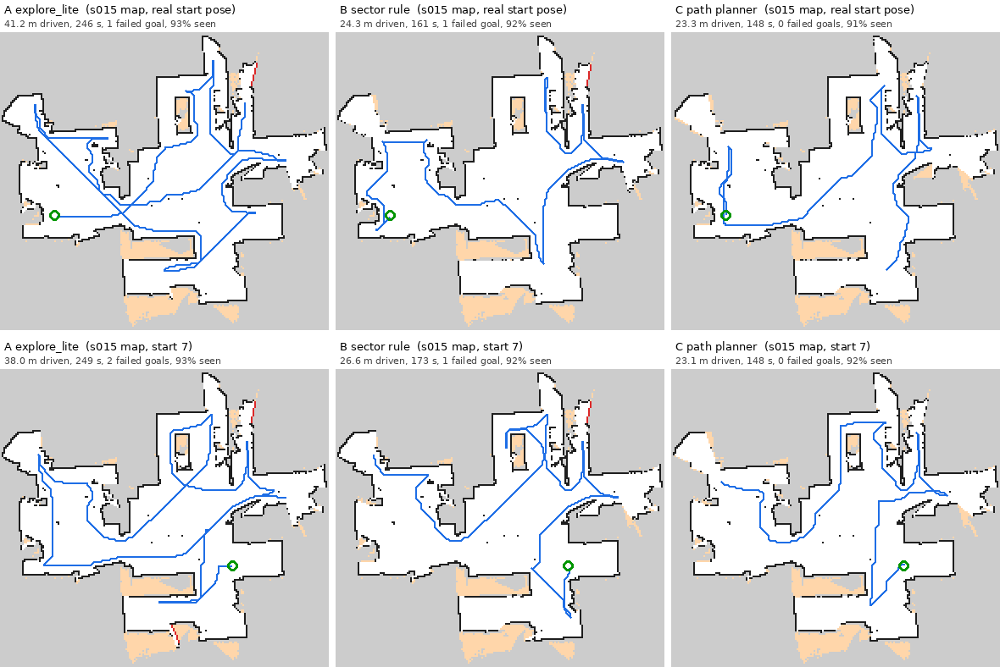
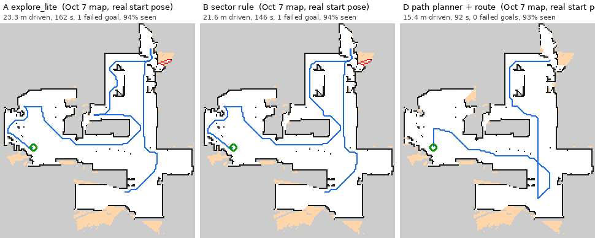
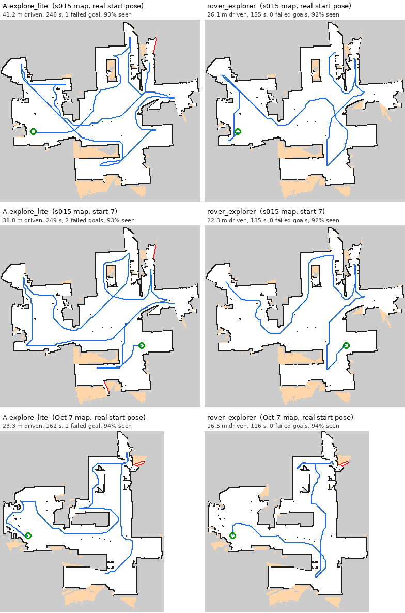
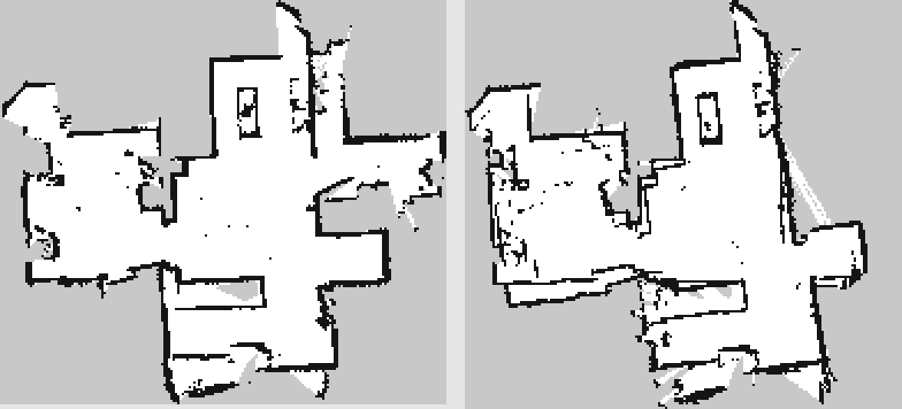

# Session 016 — 2026-10-06: Autonomous Mapping With My Own Frontier Explorer

**Date:** 2026-10-06  
**Status:** ✅ Complete

---

## Goal

Have the robot go around the house on its own, build the map as it goes, and save it
when the map is complete. I start exploration once, nobody steers, the map lands in
`maps/` by itself, and the rover drives back to where it started.

---

## Context

After Session 015 the rover had everything except the decision of where to go next:
RF2O odometry, slam_toolbox building the map live, Nav2 driving on that map, and the
pendant on the ROG Ally to start the stack, watch it and save maps. The session ran from
2026-10-06 to 2026-10-13.

My plan was to use `explore_lite` from m-explore-ros2, a standard frontier explorer that
picks the edges between known and unknown space and sends Nav2 goals to them, and to
build the rest around it: an exploration package, an autosave node and a
`rover-explore` service, started over SSH.

explore_lite did map the house. It also drove through the house several times to close
walls it could have finished in one visit, and I was not willing to call the project
done on that. Most of the session ended up being about why it explored that way, and
the explorer I wrote to replace it.

---

## Discovery 1 — Nav2 Froze Inside tf2

Early on, Nav2 stopped responding to goals while the rest of the stack kept running. A
`gdb` backtrace of the frozen process showed two threads waiting on each other inside
tf2's `Buffer`. One held the timer-to-request
mutex while it registered a new transform request; the other was running the
transformable-request callbacks under the buffer's core lock and wanted the first
mutex.

That deadlock came in with tf2 0.25.23, the version on my Jetson (geometry2 pull
request #974), and was fixed in 0.25.24 (pull request #990), which runs those callbacks
outside the locks. 0.25.24 was only in the ros2-testing repository at the time. I added
that source temporarily, simulated the upgrade first, installed exactly the thirteen
geometry2 packages at their 0.25.24 versions, checked each one with `dpkg-query`, and
removed the testing source again.

---

## Discovery 2 — Crashes Left Fast DDS Shared Memory Behind

After the tf2 upgrade, SLAM came up but Nav2 again ignored goals, and this time
`ros2 lifecycle get` itself hung. The backtraces were different: new processes were
stuck creating their Fast DDS shared-memory channels
(`SharedMemTransport::CreateInputChannelResource`). The earlier crashes had left stale
shared-memory state behind, and every new participant tripped over it. A reboot cleared
it, Nav2 came up, and the TF monitor I had been watching held steady.

---

## Discovery 3 — A Soft Carpet Browned Out the Jetson

One run was going well until the rover reached a very soft carpet. The motors pulled
hard enough that the pack sagged to about 10 V and the Jetson lost power mid-run. One
pack feeds both the Jetson and the motors, so a high-drag floor can take the computer
down with it. I hadn't been watching the voltage; I recharged and kept it in view for
every run after that.

---

## Discovery 4 — explore_lite's Return Home Canceled Itself

Runs now completed and saved their maps, but the rover stayed where exploration ended
instead of driving back to its start. The node's event log and explore_lite's source
explained it. When explore_lite finishes, its `stop()` asks Nav2 to cancel all goals and
then immediately sends the return goal. The cancel is asynchronous, so it can arrive
after Nav2 has accepted the return goal and cancel that too.

I turned explore_lite's `return_to_init` off and moved the return into my autosave node,
which records the robot's pose from TF when it starts, waits 2 s after exploration
completes so explore_lite's cancel-all has landed, then sends one Nav2 goal back to the
start and retries it if Nav2 rejects or aborts it.

---

## Discovery 5 — explore_lite Mapped the House, Inefficiently

With the return fixed, the 12:25 run on Oct 7 did everything on paper: it explored the
whole house, saved the map and drove home, in 591 s. Watching it was a different story.
It seemed to pick frontiers at random, crossed the house several times, and kept
abandoning goals halfway.

Nav2's journal for that run confirmed it:

| What happened | Count |
|---|---|
| Exploration goals sent | 57 |
| Goals completed | 0 |
| Goals abandoned mid-route (replaced by a new goal) | 51 |
| Goals failed | 5 |
| Recovery sequences (spin, backup, wait) | 11 |
| "Failed to make progress" stalls | 4 |

From the recovery settings I estimated roughly 225 s, about 38% of the run, stuck or
recovering. The run also ended as `all_blacklisted` rather than "no frontiers left":
some frontiers sat behind 1 cm gaps between boxes on the floor. The lidar could see
through the gaps, so the unknown space behind them looked like a frontier, but the
rover could never get there.

Reading explore_lite's source at the pinned commit gave four reasons:

- A frontier's cost is `3.0 × straight-line distance − 1.0 × size`, so a frontier on the
  other side of a wall looks close.
- It re-scores every 6.7 s and switches goals freely, with no commitment to the current
  one.
- The goal is the frontier's centroid, which can be an unreachable point, and
  reachability ignores the robot's size.
- On Humble, every aborted goal blacklists its frontier for the rest of the run.

My first idea for a fix was a forward sector: if a frontier lies within 2 m, within
±35° of the heading and in line of sight, finish that first; otherwise go to the
nearest one. Before changing anything on the robot I wanted to know which idea actually
helps, and by how much.

---

## Discovery 6 — A Simulator Showed What Actually Helps

I wrote an offline exploration simulator, [`tools/explore_sim/sim.py`](../../tools/explore_sim/sim.py),
so I could run every candidate policy from the same start poses on real maps of this
house and compare numbers instead of impressions.

- **Ground truth:** a saved SLAM map. Free cells are free; occupied and never-seen cells
  are solid.
- **Lidar:** 360°, 12 m, 500 rays, like the RPLIDAR C1. The simulated robot builds its own
  map from scratch.
- **Navigation:** modelled on my Nav2 config. Footprint 0.25 × 0.227 m (inscribed radius
  0.1135 m), 0.22 m/s, 0.6 rad/s spin when the heading error is over 0.5 rad, NavFn with
  unknown space allowed and 0.25 m tolerance, 0.15 m goal tolerance, a 1 Hz replan, and
  20 s lost for every failed goal.
- **Starts:** the same 10 start poses per map for every policy.
- **Limits:** perfect sensing and localisation, and no recovery behaviours beyond the
  penalty. It under-counts real-world failures: on the Oct 7 map the simulated
  explore_lite needs about 160 s against 591 s on the robot.

The policies:

- **A:** explore_lite as configured.
- **A2:** explore_lite with `gain_scale` 0 and `planner_frequency` 0.05, a parameter-only
  fix.
- **B:** my sector rule.
- **C:** a planner built on what the root causes pointed at. Reachability is a flood fill
  over known-free cells the robot's body fits in; cost is the driving distance along
  that path, plus a turn penalty; the goal is a viewpoint that sees a real part of the
  frontier, not a grazing glance along it; it commits to its current target; and it
  gives up on a frontier only after standing at its viewpoint and learning nothing.
- **D:** C plus a route through all frontiers, ordered by nearest neighbour and improved
  with 2-opt on driving distances between viewpoints.

s015 full-house map (33 m² of floor), mean of 10 starts:

| Policy | Distance | Time | Failed goals |
|---|---|---|---|
| A explore_lite | 30.2 m | 198 s | 1.5 |
| A2 parameters only | −9% | 0% | 1.6 |
| B sector rule | −7% (worst start +61%) | −6% | 1.3 |
| C path planner | −24% | −29% | 0 |
| D path planner + route | −25% | −29% | 0 |

Oct 7 map with the boxes (25 m²), mean of 10 starts, with one explore_lite run left
out because it oscillated between two frontiers for the full simulated hour (491 m):

| Policy | Distance | Time | Failed goals |
|---|---|---|---|
| A explore_lite | 23.4 m | 147 s | 0.8 |
| A2 parameters only | +2% | +12% | 1.1 |
| B sector rule | +2% | +13% | 1.4 |
| C path planner | −17% | −21% | 0 |
| D path planner + route | −24% | −28% | 0 |

From the real Oct 7 start pose: explore_lite 23.3 m, sector rule 21.6 m, D 15.4 m.



*Simulated runs on the s015 map from two start poses. Blue is the path driven, red the
frontiers given up on, orange free space never seen.*



*The Oct 7 map from the real start pose.*

What the numbers said:

- My sector rule doesn't survive a 360°, 12 m lidar. Anything in line of sight within
  2 m is already known, so the sector is almost always empty and the rule turns into
  nearest-frontier. Its worst start drove 61% more than explore_lite.
- Tuning explore_lite's parameters does not fix it.
- Path distance, reachability for the robot's body and commitment carry most of the
  gain. The route through all frontiers adds about 7 points on the cluttered map and
  nothing on the open one.
- I had set myself a 30% distance target and the simulator gave 24 to 25%. I decided to
  treat the simulator as design validation rather than keep tuning against it.

That settled it: I would replace explore_lite with my own explorer built on D.

---

## Discovery 7 — Porting the Planner Found a Failure the Simulator Policy Had

I moved every decision into one module with no ROS imports,
`rover_explore/frontier_planner.py`, and made the simulator run that exact file as a
policy. Whatever the robot does, the simulator has already done.

The Jetson has numpy and scipy but not scikit-image, which the simulator's path search
used, so the module finds paths with scipy's Dijkstra on an 8-connected grid graph.
Decisions came out identical on numpy 2.5 / scipy 1.18 and on Ubuntu 22.04's numpy
1.21.5 / scipy 1.8.0 across 30 map snapshots.

An exact port reproduced D: 21.9 m against 22.8 m on s015 and 18.7 against 17.7 m on
the Oct 7 map, within run-to-run noise. Two changes came out of re-validating it.

**Room around the goal.** Viewpoints keep 0.25 m of clearance, my Nav2 inflation
radius, whenever a viewpoint with that much room can see the frontier. The robot's
circumscribed radius is 0.169 m, and goals tucked against obstacles were behind the
Oct 7 stalls. In simulation the margin costs distance: it is most of the gap between
the exact port (21.9 m on s015) and the final configuration (24.4 m). I kept it,
because the simulator does not charge for the real cost of a goal Nav2 cannot reach
cleanly.

**Gap strips.** One start on the Oct 7 map lost a whole region (85% coverage). When the
lidar sees through a gap, it paints thin free strips into unknown space. The frontier
along those strips looks visible from where the robot already stands, so it "arrived"
instantly, learned nothing, and gave the frontier up for good. Now, when a viewpoint
teaches a frontier nothing, the next try has to come from at least 1 m away, and the
frontier is only excluded after two such places.

Final configuration against explore_lite on the same starts:

| Map | explore_lite | rover_explorer | Change | Worst-start coverage |
|---|---|---|---|---|
| s015 full house | 30.2 m | 24.4 m | −19% | 91.4% (D: 86.6%) |
| Oct 7 (same nine starts) | 23.4 m | 16.8 m | −28% | 90.9% (D: 91.1%) |

Over 30 starts it drives 7% more than D on s015 and 5% less on the Oct 7 map.



*Simulated explore_lite (left) and rover_explorer (right), running the same
`frontier_planner.py` the robot runs.*

---

## Discovery 8 — The Final Map Save Failed During the Drive Home

The first robot run with my explorer explored the house and drove home, but the final
map never reached `maps/`. The checkpoint at 308 s had saved normally. All four
final-save attempts ran while the rover was driving home, and all four failed the same
way: the map saver exited after about 4 s and wrote nothing. The pose graph still
serialized, so nothing was lost, and I saved the map from the pendant once the rover was
home. A save from the pendant while the rover drove a long Nav2 goal also worked.

I changed the order. The autosave node now drives home first and saves the final map
once the drive home has ended, however it ended: reached, failed, timed out or
canceled. The save now happens with the rover at rest.

---

## Solution / What Was Done

### The exploration package

`src/rover_explore` holds the launch file, the parameters, the autosave node and my
explorer:

| File | Role |
|---|---|
| `launch/explore.launch.py` | Starts the autosave node, then the explorer 3 s later; `explorer:=rover` (default) or `explorer:=explore_lite`. If either node exits, the launch shuts down. |
| `config/explore_params.yaml` | Parameters for `rover_explorer`, `explore_node` and `explore_autosave`. |
| `rover_explore/frontier_planner.py` | Every exploration decision. numpy and scipy only, no ROS. |
| `rover_explore/explorer_node.py` | The `rover_explorer` node: map, pose, Nav2 goals, status. |
| `rover_explore/autosave_node.py` | Checkpoints, the final map, the return home, run logs. |

m-explore-ros2 is pinned at commit `326cf8a` in `rover.repos`, so `explore_lite` stays
available as the baseline.

`tools/systemd/rover-explore.service` runs the launch. It refuses to start unless
`rover-bringup` and `rover-nav2` are running, and stopping it pauses exploration first
(`/explore/resume` false), then sends SIGINT:

```bash
systemctl --user start rover-explore
journalctl --user -u rover-explore -f -o cat
```

### tf2

geometry2 0.25.24 from ros2-testing, installed with exact version pins for all thirteen
packages after a dry-run simulation, with the testing source removed afterwards.

### The explorer

`rover_explorer` re-plans every 2 s, and right after each Nav2 goal ends, once the map
has updated (up to 3 s). It sends one goal at a time and re-sends it only when the
target viewpoint moves 0.5 m or more; Nav2 aborts a replaced goal on Humble, and the
node ignores results from replaced goals. It declares exploration complete only after
two decisions in a row, each on a newer map, find no reachable frontier. It publishes
the same `/explore/status` messages as explore_lite and obeys the same
`/explore/resume` topic, cancels only its own goal, cancels it on Ctrl-C before it
exits, and draws the frontiers, the target and the excluded frontiers on
`/explore/frontiers` for Foxglove.

The planner's main parameters, all in `explore_params.yaml`:

| Parameter | Value | Meaning |
|---|---|---|
| `goal_clearance` | 0.25 m | Room a viewpoint should have |
| `min_frontier_size` | 0.5 m | Shorter frontiers are ignored |
| `view_radius` | 1.5 m | Farthest a viewpoint may be from its frontier |
| `view_half_angle_deg` | 60° | Viewing cone around the frontier's open side |
| `keep_ratio` | 1.0 | Keep the target unless the route is shorter without it |
| `resend_distance` | 0.5 m | Viewpoint movement that re-sends the goal |
| `viewpoint_attempts` | 2 | Viewpoints tried before a frontier is excluded |
| `retry_spacing` | 1.0 m | Minimum distance between those viewpoints |
| `failed_retries` | 1 | Nav2 failures tolerated per frontier |

`min_frontier_size` is 0.5 m rather than the 0.75 m default, because the doorway
frontier into one room is about 0.76 m wide and the default dropped it.

### The autosave node

`explore_autosave` saves a checkpoint every 5 minutes through `/pendant/save_map` and
moves it into the run folder, serializes the slam_toolbox pose graph with every save,
and logs events and battery voltage to CSV files in `~/rover_runs/<run>/`. When
exploration completes it drives the rover back to its start pose, then saves the final
map into `maps/`. For comparing runs it also counts Nav2's own log lines (goals begun,
succeeded, failed, canceled and preempted, progress failures, spins, backups, waits),
adds up the distance driven from `/odom`, and records both at completion and at
shutdown.

### The simulator

`tools/explore_sim/` holds the simulator (`sim.py`), the policies compared above
(`policies.py`), the wrapper that runs `frontier_planner.py` as a policy
(`module_policy.py`), the runner and the table script (`compare.py`, `summarize.py`),
the script that draws the figures above (`figures.py`) and the raw results.
`run_all.sh` re-runs every comparison in this log.

### Testing before the robot

Before the explorer touched the rover, I ran it inside a ROS 2 Humble container against
a simulated rover: a lidar-built `/map`, TF, `/odom`, and a NavigateToPose server that
drives and preempts the way Nav2 does. Full runs on both maps completed, saved the map
and drove home. Pausing and resuming mid-run, injected Nav2 failures, a stop during the
drive home, Ctrl-C with a goal active, the explore_lite baseline, an invalid explorer
name, and a node waiting without a map or TF all behaved as designed. The install on
the Jetson checked every file by checksum, ran the planner on four partly explored
copies of the s015 map (all four decisions identical to the simulator machine, slowest
0.17 s), and smoke-tested both nodes in a private ROS domain where they could not reach
the rover.

---

## Result

The rover now explores the house on its own with my explorer, finishes one area before
moving to the next, and drives back to where it started.

The first robot run, on 2026-10-13, against the explore_lite run from Oct 7. The boxes
were gone by then, so this is not a controlled comparison:

| | Oct 7, explore_lite | Oct 13, rover_explorer |
|---|---|---|
| Exploration time | 591 s | 453 s |
| Goals completed | 0 of 57 | 20 of 66 |
| Failed goals | 5 | 1 |
| Progress stalls | 4 | 3 |
| Ended as | `all_blacklisted` | `no_reachable_frontiers` |

- It drove 34.6 m while exploring and 41.3 m including the 71.5 s drive home. The Oct 7
  run had no distance measurement.
- Reflective surfaces created areas the lidar saw but the rover could never reach. At
  the end it skipped 8 frontiers that had no reachable viewpoint instead of driving at
  them.
- Planning on the Jetson took 0.24 s per decision on average and 0.59 s at worst.
- The map has every room of the Session 015 map, with 30.9 m² of free floor against
  32.7 m² in Session 015; furniture and doors differ between the two.



*Left: the Session 015 map, driven by hand and with Nav2. Right: the map the rover built
on its own on Oct 13.*

The distance the robot drove is well above the simulator's 24.4 m mean for this house,
and the time against Oct 7 compares two different floor layouts. The efficiency figures
I trust are the simulated ones above.

---

## Lessons Learned

**Measure the behaviour before changing it.** Tuning explore_lite would have felt like
progress. The simulator showed it was not, and showed that my own first idea made one
start much worse.

**Simulate the code, not a description of it.** Because the robot runs the same
`frontier_planner.py` the simulator runs, the gap-strip failure showed up on my desk
instead of in the house.

**A simulator with perfect sensing is optimistic about everything that goes wrong.** It
under-counted explore_lite's real failures and my explorer's real distance alike. I
used it to rank designs, not to promise numbers.

---

## Next Session Goal

Project #1 is complete. The next and final log explains how each node works,
algorithm by algorithm, and closes the project with a short conclusion.
