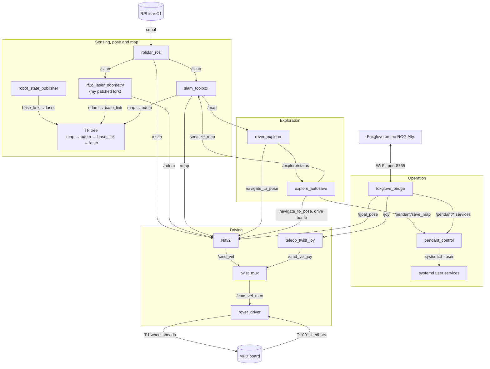
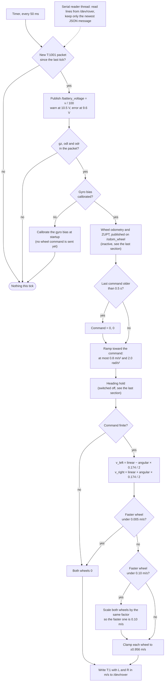
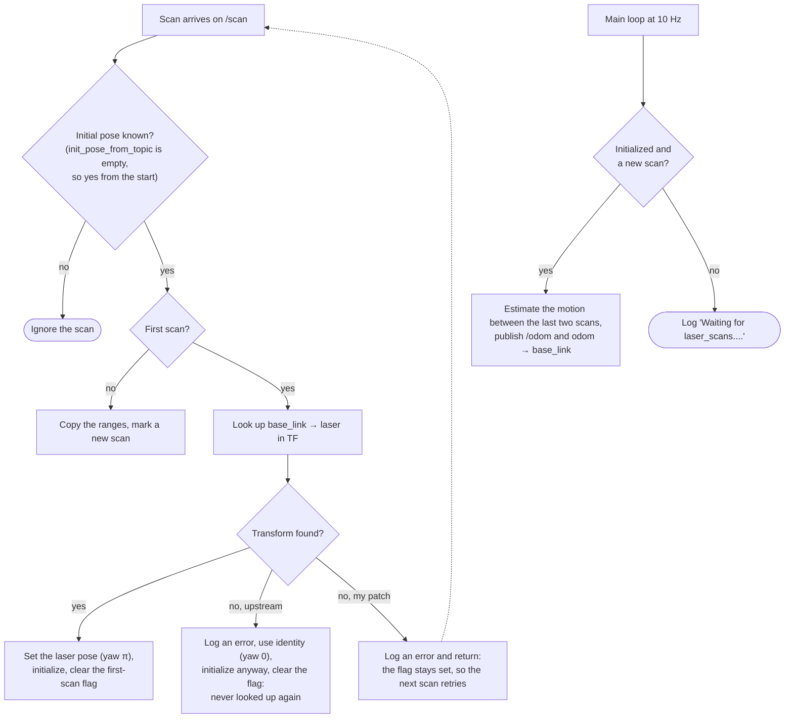
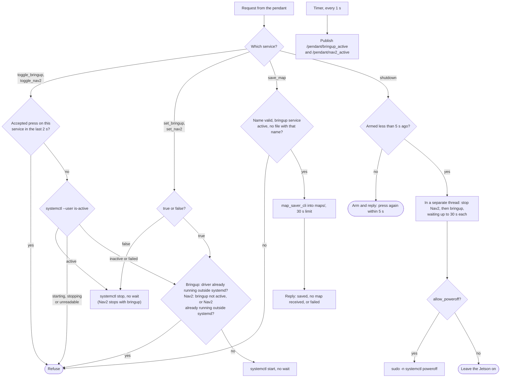
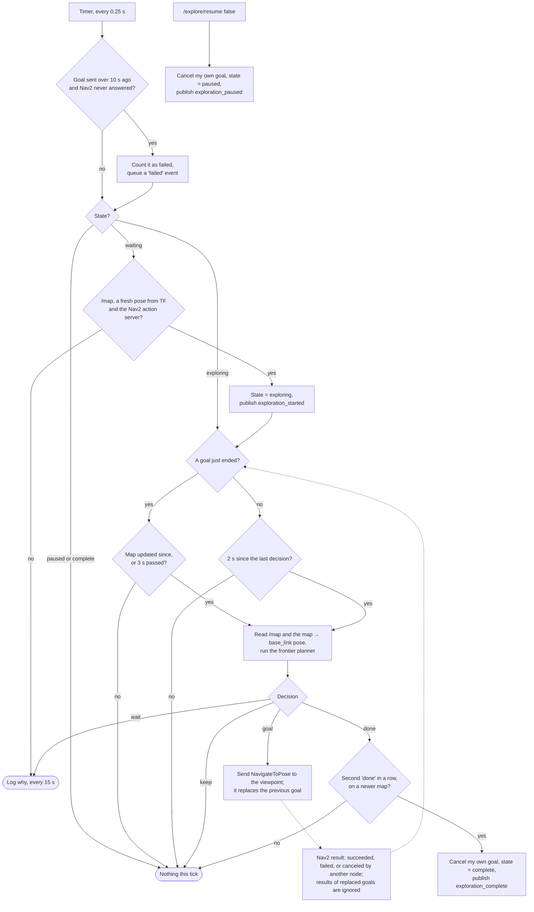
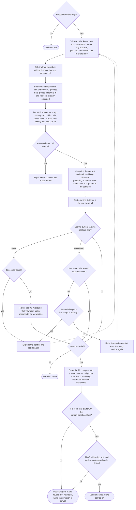
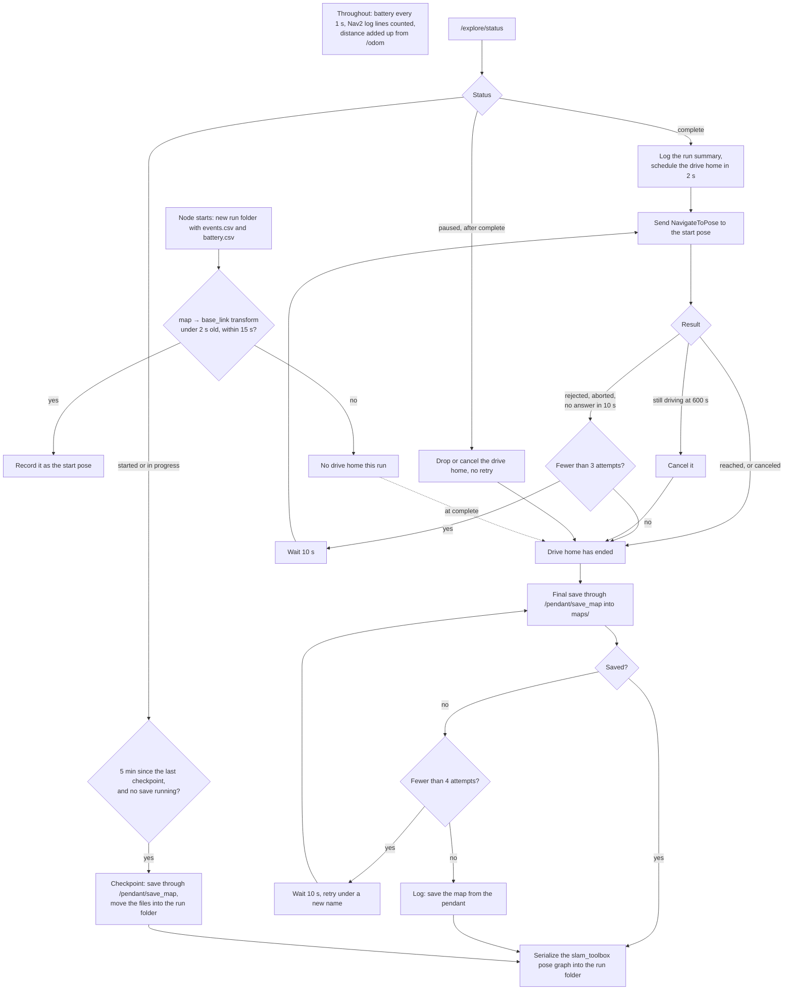
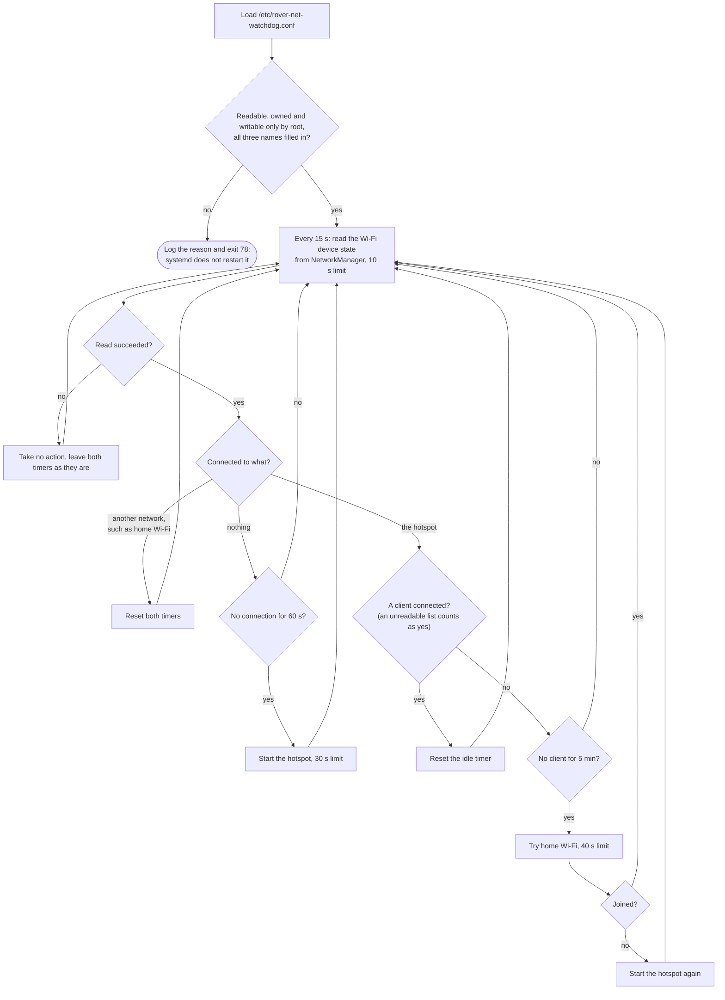
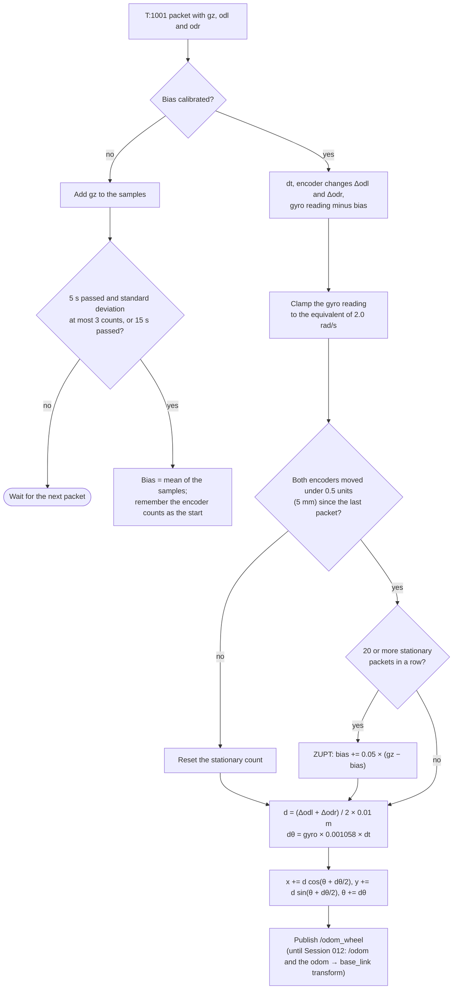
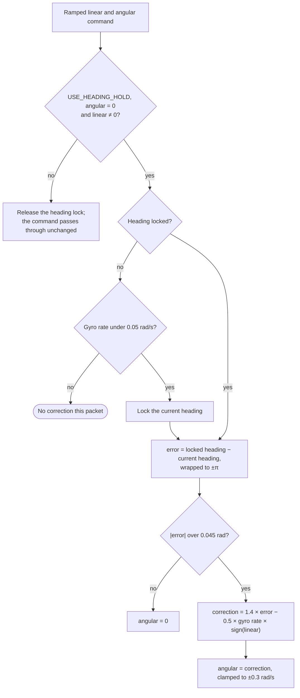

# Session 017 — 2026-10-13: How Each Node Works, and the Conclusion of Project #1

**Date:** 2026-10-13  
**Status:** ✅ Complete

---

## Goal

Project #1 is finished: the rover maps the house on its own, drives home, saves the map,
and navigates to goals I set from a handheld pendant. This last session explains how
every node I wrote works, one flowchart each, in language for someone who knows what a
robot is but not what a costmap is, and why each one is built the way it is. It closes
the project with a short conclusion.

---

## Context

The code I wrote is `rover_driver`, `pendant_control`, `rover_explorer` with its planner,
`explore_autosave`, a one-line fix to RF2O, and the network watchdog. The third-party
nodes (the lidar driver, RF2O, slam_toolbox, Nav2, `twist_mux`, `teleop_twist_joy`,
`foxglove_bridge` and `robot_state_publisher`) appear only in the system overview, with
what goes in, what comes out and why I chose them.

I drew every chart from the code as it stands at the end of Session 016, and read the
session logs for the reasons behind it. Where an older log and the code disagree, the
charts follow the code. Reading the code closely also turned up comments that still
described earlier versions of it: in `rover_driver_node.py`, in `nav2_params.yaml`, and
in the planner's docstring. I corrected those comments, the text in both READMEs about
the driver's command watchdog and ZUPT's timing, and the build notes in
`docs/software/rf2o-laser-odometry.md`, which still pointed at the upstream RF2O
repository instead of my fork. No code changed.

How to read the charts: a rectangle is a step, a diamond is a decision with its answers
on the arrows, a rounded box is where a path ends, and a dashed arrow is something that
happens later, such as a reply arriving.

A few terms the rest of the log uses:

- A **topic** is a named stream of messages, such as `/scan`. Anyone can publish or
  listen.
- A **service** is a request with one reply, such as `/pendant/save_map`.
- An **action** is a long request that ends with a result, such as Nav2's
  `navigate_to_pose`: "drive here, and tell me when you get there or give up".
- **TF** is the tree of coordinate frames that says where everything is: `map` is the
  fixed frame of the map, `odom` is a smooth frame that drifts slowly, `base_link` is the
  robot's body and `laser` is the lidar.
- A **costmap** is Nav2's grid of how risky each spot is to drive through: walls, plus a
  margin around them.
- A **frontier** is the edge between floor the robot has seen and space it has not seen
  yet.

---

## System Overview



The lidar is the robot's only outward sensor. `rplidar_ros` turns its serial stream into
`/scan`, ten 360° sweeps a second. RF2O compares consecutive scans to work out how the
robot moved, which gives `odom → base_link`. slam_toolbox builds the map from the same
scans and corrects RF2O's slow drift, which gives `map → odom`. `robot_state_publisher`
adds where the lidar sits on the chassis. Nav2 plans a path on the map, follows it and
publishes velocity commands on `/cmd_vel`. `twist_mux` picks between those commands and
the pendant's joystick, and `rover_driver` turns the winner into wheel speeds for the
motor board.

The pendant is Foxglove on the ROG Ally, connected over Wi-Fi to `foxglove_bridge`. That
connection is the only part of the system that leaves the Jetson, which is why every
node runs with `ROS_LOCALHOST_ONLY=1` (Session 015). For autonomous mapping,
`rover_explorer` decides where to go next and sends Nav2 goals, and `explore_autosave`
saves the map, drives the rover home and logs the run.

| Node | In | Out | Why it is in the stack |
|---|---|---|---|
| `rplidar_ros` | RPLidar C1 over `/dev/lidar` | `/scan` at 10 Hz | Slamtec's driver, built from source because the packaged version had no C1 support (Session 004) |
| `rf2o_laser_odometry` | `/scan`, `base_link → laser` | `/odom` and `odom → base_link` | Lidar odometry does not depend on the floor surface or the temperature, the two things that kept gyro calibration from holding (Session 012). I run my patched fork ([below](#the-rf2o-startup-fix)) |
| `slam_toolbox` | `/scan`, `odom → base_link` | `/map` every 1 s, `map → odom` | Live mapping with loop closure, synchronous mode with the Ceres solver. The 15 m loop-closure search radius proved itself in an A/B run (Sessions 010 and 013) |
| `robot_state_publisher` | `rover.urdf` | `base_link → laser` | The lidar sits 0.1685 m above `base_link`, turned 180°, because its zero bearing faces the rear (Session 013) |
| Nav2 | `/map`, `/scan`, `/odom`, TF, goals | `/cmd_vel` | Regulated Pure Pursuit rather than DWB: fewer parameters and more forgiving of wheel slip. Its acceleration limits are the measured 0.648 and 0.699 m/s² (Session 013) |
| `twist_mux` | `/cmd_vel` (priority 10), `/cmd_vel_joy` (100), two locks | `/cmd_vel_mux` | Nav2 publishes velocity from two places, so the mux sits on the driver's input and Nav2 stays untouched (Session 015) |
| `teleop_twist_joy` | `/joy` from the pendant | `/cmd_vel_joy` | Stick driving behind the LB deadman, up to 0.25 m/s and 1.5 rad/s (Session 015) |
| `foxglove_bridge` | Foxglove on the Ally, port 8765 | every topic and service the pendant uses | Foxglove already draws maps, scans, costmaps and paths and sends goals, so I wrote no app for the Ally (Session 015) |
| [`rover_driver`](#rover_driver) | `/cmd_vel_mux`, feedback from the board | wheel speeds, `/battery_voltage`, `/odom_wheel`, `/imu/gz` | Mine |
| [`pendant_control`](#pendant_control) | `/pendant/*` services | systemd services, map files, state topics | Mine |
| [`rover_explorer`](#rover_explorer) | `/map`, TF, Nav2 results | Nav2 goals, `/explore/status` | Mine |
| [`explore_autosave`](#explore_autosave) | `/explore/status`, TF, `/battery_voltage`, `/odom` | map saves, the drive home, run logs | Mine |

Two more pieces of mine are not ROS nodes. The systemd user services start and stop the
stack, and after every stop or crash of bringup `rover_zero_motors.py` writes the zero wheel
command to the board twice, 50 ms apart, because the board keeps executing its last
command (Session 015). The [network watchdog](#the-network-watchdog) keeps a Wi-Fi link
up for the pendant.

---

## `rover_driver`

**In:** velocity commands on `/cmd_vel_mux`, and feedback packets from the motor board.  
**Out:** wheel speed targets to the board, `/battery_voltage`, and `/odom_wheel` and
`/imu/gz`, which nothing in the running stack uses any more.



The motor board speaks JSON over USB serial. About 20 times a second it sends a T:1001
feedback packet with the battery voltage, the gyroscope and the wheel encoders, and it
accepts T:1 commands that set a target speed for the left and right wheels. A background
thread reads the serial port line by line and keeps only the newest packet. A timer runs
every 50 ms and handles that packet if a new one has arrived. Because the timer takes
only the newest packet and does nothing when none has arrived, the node really works at
the rate packets get processed, about 12 Hz when I measured it in Session 014, not at the
timer's 20 Hz. Everything below happens at that rate, including every wheel command.

For each packet the node publishes the battery voltage first. At startup it then spends
5 to 15 seconds measuring the gyroscope's bias with the robot still, and sends no wheel
command at all during that time, so the rover ignores driving commands for the first
seconds after bringup. After that, each packet updates the wheel odometry (covered in
the [last section](#algorithms-no-longer-active-on-the-robot)) and then works out the
wheel command:

1. **Watchdog.** If the last velocity command is more than 0.5 s old, the command
   becomes zero.
2. **Ramp.** The speed sent to the wheels chases the command, changing by at most
   0.8 m/s² in forward speed and 2.0 rad/s² in turn rate. From standing to Nav2's
   0.22 m/s takes about 0.3 s.
3. **Mix.** A forward speed and a turn rate become two wheel speeds: each wheel runs at
   the forward speed, plus or minus the turn rate times half the 0.174 m track width.
4. **Floor.** If the faster wheel is under 5 mm/s, both wheels get exactly zero. If it
   is under 0.10 m/s, both wheels are scaled up by the same factor until the faster one
   reaches 0.10 m/s.
5. **Clamp.** Each wheel is limited to ±0.956 m/s, the measured top speed. A command
   that is not a finite number becomes zero.

**Why m/s and not duty.** For most of the project I treated the T:1 values as motor duty.
In Session 014 I ran the wheels in the air and on the floor: the board held the same
commanded speed under both loads, so T:1 is closed-loop wheel speed in m/s and the board
was already running the speed controller I had been about to write. Dividing by 0.956
had been inflating every target by 4.6%.

**Why the floor.** The same session's in-place rotation test, on the easiest floor in the
house, the harshest and one in between, showed the board cannot regulate a wheel below
about 0.08 m/s: with 20 pulses per revolution, the encoders do not resolve slower motion.
Nav2's in-place turn at 0.6 rad/s asked each wheel for 0.052 m/s, which was the entire
reason the rover stalled when it tried to turn on the spot. I chose 0.10 m/s for margin.
Scaling the two wheels together keeps their ratio, so the curve Nav2 asked for is kept
and only the speed rises. In a tight arc the inner wheel can still end up under the floor
and turn less than asked; Nav2's feedback corrects for that.

**Why the physical track width.** `TRACK_WIDTH` is the caliper-measured 0.174 m (Session
013), not the 0.08 m that the calibration script fitted for computing heading from the
encoders (Session 008). Those are different jobs. The rover actually turns at about 43%
of the rate the wheel speeds predict, because its six wheels scrub sideways, which works
out to an effective track of about 0.405 m (Session 014). I left the mix on the physical
value, and Nav2's closed loop absorbs the difference.

**Why the ramp.** One battery pack feeds both the Jetson and the motors. A full-speed
start from standing drew enough current to sag the pack below what the Jetson needs, and
it shut down (Session 009). The ramp ended that (Session 010). Nav2's own acceleration
limits sit below the ramp, at the 0.648 m/s² and 0.699 m/s² I measured in Session 013,
so Nav2 never asks for more than the motors can do.

**Why the watchdog, and its limit.** I added the 0.5 s watchdog in Session 013 so a
crashed Nav2 cannot leave the rover driving on its last command. Reading the code for
this log showed its limit: the check runs only when a feedback packet is processed, like
every wheel command. If the board's feedback stops, or the serial reader thread stops on
an error (it exits without logging anything), no further command goes out, so neither
the watchdog's zero nor any other command reaches the board, and the board keeps
executing the last one. The same holds if the driver alone crashes: the rest of bringup
keeps running, and `rover_zero_motors.py` runs only when the whole bringup service stops.
The chassis power switch remains the real emergency stop.

**Battery.** The pack voltage arrives in every packet as volts × 100. The node publishes
it and logs a warning at 10.5 V and an error at 9.6 V, each at most once every 30 seconds
(Session 014).

**No transform.** The driver used to publish `odom → base_link` from its own odometry.
Since Session 012 RF2O owns that transform, because a transform can have only one
publisher.

---

## The RF2O Startup Fix

**In:** `/scan`, and the `base_link → laser` transform.  
**Out:** `/odom` and the `odom → base_link` transform.

RF2O is third-party code, so I drew only the part I changed.



RF2O estimates how the lidar moved between two consecutive scans from how every range in
the scan changed, then converts that into the robot's motion using where the lidar sits
on the robot. It reads that position from TF once, on the first scan. Upstream, if the
lookup fails, the error is logged, RF2O carries on with an identity transform (no
offset, no rotation), clears the first-scan flag, and never looks again.

That was harmless until Session 013, when I found that the C1's zero bearing faces the
rear and turned the laser frame 180° in the URDF. From then on, a failed lookup meant
RF2O believed the lidar faced forward. Rotation still came out right, but translation
came out negated: driving forward showed up in `/odom` as reversing. It happened on 6 of
the 8 launches I made in one day (Session 014), because the lidar is already streaming
when RF2O starts, and RF2O's first scan arrives before its own TF listener has received
the transform from `robot_state_publisher`. A 3 s launch delay cannot help, since both
sides of the race start at the same moment.

My fix is one line in `CLaserOdometry2DNode.cpp`:

```diff
-      setLaserPoseFromTf();
+      if (!setLaserPoseFromTf()) return;
```

A failed lookup now skips initialization and leaves the flag set, so the next scan tries
again. If `robot_state_publisher` never starts, RF2O publishes no odometry rather than
wrong odometry. It is the only difference between my fork, `ArshamFN/rf2o_laser_odometry`
at `82a99d4` (pinned in `rover.repos`), and the Adlink-ROS `humble-devel` port it is based
on, at `313bb4c`. I proved it in Session 014 by forcing the race: with
`robot_state_publisher` withheld, RF2O logged 67 failed lookups and published nothing;
starting it ended the errors, and RF2O initialized with yaw 3.141593 and published `/odom`
at about 9.3 Hz.

The first decision in the chart is the other RF2O lesson. Its `init_pose_from_topic`
parameter defaults to a simulation-only topic, and RF2O ignores every scan until a pose
arrives on it. Left at the default, it waits forever without an error. Setting it empty
in `rf2o_params.yaml` fixed that in Session 012.

---

## `pendant_control`

**In:** service calls from Foxglove, relayed by `foxglove_bridge`.  
**Out:** `systemctl --user` commands, saved maps, `/pendant/bringup_active` and
`/pendant/nav2_active` once a second, one line per command on `/pendant/control_result`,
and a power-off.



The pendant starts and stops the stack through systemd user services instead of
terminals. `pendant_control` is the only node that touches them. A toggle reads the
service's live state: if it is running it stops it, if it is stopped it starts it, and
while it is starting, stopping or unreadable it refuses. Presses less than 2 s after an
accepted one are refused. The `set_bringup` and `set_nav2` services start or stop
explicitly, with the same start checks. Starting bringup is refused if a driver started
outside systemd is already running, and Nav2 is refused unless bringup's service is
active, or if a Nav2 started elsewhere is already running.

A map save takes a name of letters, digits, `_` and `-`, up to 64 characters, refuses if
either file already exists, and runs `map_saver_cli` with a 30 s limit. It requires the
`rover-bringup` service to be active, so a bringup started from a desktop launcher cannot
save through the pendant. The reply tells saved, no map received, and failed apart, which
`explore_autosave` relies on.

Shutdown needs two presses within 5 s. The second press starts a separate thread that
stops Nav2, then bringup, waiting up to 30 s for each, and then powers off with
`sudo -n /usr/bin/systemctl poweroff`.

**Why systemd, and why the zero command.** Services let the pendant control the stack
with nobody at a terminal, and they start at boot. Stopping the stack is the dangerous
part, because the board keeps executing its last wheel command, so every stop of bringup
ends with `rover_zero_motors.py`. My test was stopping bringup from the pendant while the
wheels were turning (Session 015).

**Why toggles with a debounce.** The first version had separate start and stop buttons.
One toggle per service, reading the real state each time, is harder to press wrongly, and
the 2 s debounce stops a double tap from starting and then stopping a service.

**Why refuse a second stack.** A desktop launcher and the pendant could otherwise start
two copies of the stack on top of each other (Session 015).

**Why the shutdown is guarded three ways.** Two presses within 5 s prevent an accidental
power-off. The sudo rule allows exactly one command, and `-n` makes a missing rule fail
at once instead of waiting for a password. The node powers off only when its
`allow_poweroff` parameter is true, which only the installed service sets, so running the
node by hand stops the stack but leaves the Jetson on.

**Why every command runs the way it does.** Each external command runs without a shell,
in its own process group with a time limit, so a hung `systemctl` or map saver is killed
along with everything it started. The node handles requests on several threads, so a slow
command cannot block the status topics or another button.

---

## `rover_explorer`

**In:** `/map`, the robot's pose from TF, `/explore/resume`, and the results of its
Nav2 goals.  
**Out:** `navigate_to_pose` goals, `/explore/status`, and frontier markers on
`/explore/frontiers` for Foxglove.



The node is a thin shell around the planner. It holds the state (waiting, exploring,
paused or complete), decides when to plan, and talks to Nav2. Every 0.25 s it checks
whether it is time to plan: every 2 s, and also right after a goal ends, once the map
has updated or 3 s have passed, so the decision uses the map as seen from where the rover
stopped. A "goal" decision is sent to Nav2 as a new `navigate_to_pose` goal, which
replaces the previous one; Nav2 aborts the replaced goal, and the node ignores results
from replaced goals so they do not count as failures. A goal Nav2 never answers within
10 s counts as failed.

Exploration is complete only after two "done" decisions in a row, the second on a newer
map, so a single decision cannot end the run. Then it cancels its own goal and publishes
`exploration_complete`. `/explore/resume` false pauses it and cancels its goal, and true
resumes. On Ctrl-C it cancels its goal before exiting. It never publishes velocity; Nav2
does all the driving.

**Why it speaks explore_lite's language.** It publishes the same `/explore/status`
messages and obeys the same `/explore/resume` topic as explore_lite, so the autosave node
and the `rover-explore` service work with either, and explore_lite stays available as a
baseline (Session 016).

**Why it cancels only its own goal.** explore_lite cancels every Nav2 goal when it
finishes, and that cancel could catch the drive home as well (Session 016).

**Why it re-sends a goal only when the viewpoint moves 0.5 m.** On Humble, Nav2 aborts a
goal that is replaced. explore_lite re-scored every 6.7 s and switched goals freely: on
Oct 7 it sent 57 goals, completed none and abandoned 51 halfway (Session 016).

---

## The Frontier Planner

**In:** a snapshot of the map as a grid, and the robot's position and heading.  
**Out:** one decision: `goal` (with a position and heading), `keep`, `wait` or `done`.



`frontier_planner.py` makes every exploration decision. It uses only numpy and scipy,
with no ROS, so the offline simulator runs the same file. A decision goes like this:

1. **Where can the robot drive?** Cells known to be free, with more than the robot's
   half-width (0.1135 m) to the nearest wall. Free cells within 0.25 m of the robot also
   count, so it can always leave a tight spot.
2. **How far is everything?** Dijkstra's algorithm, starting at the robot, gives the
   driving distance to every drivable cell, around walls rather than through them.
3. **Where are the frontiers?** Unknown cells next to free cells, grouped with their
   neighbours. Groups shorter than 0.5 m are ignored, and so are frontiers already given
   up on.
4. **Where can each frontier be seen from?** Rays are cast back from up to 32 of the
   frontier's cells through known-free space, up to 1.5 m, and only within 60° of the
   direction its open side faces, so a grazing glance along the frontier does not count.
   The viewpoint is the reachable cell, nearest by driving distance, from the first of
   four groups that has one: cells with 0.25 m of room that see at least a quarter of the
   sampled cells; cells that see that much without the room; cells with the room that
   see at least one; and any reachable cell that sees one. A frontier no reachable cell can
   see is skipped instead of tried and failed.
5. **What does it cost?** The driving distance to the viewpoint, plus the turn needed to
   set off, converted into metres at the robot's speed and turn rate.
6. **Did the last goal teach anything?** If Nav2 failed the current target's goal, the
   area within 0.3 m of that viewpoint is never used again and a different viewpoint is
   chosen; a second failure excludes the frontier. If the goal succeeded but fewer than
   10 cells around the frontier became known, the frontier cannot be seen from there:
   the next try must come from at least 1 m away, and after two such places the frontier
   is excluded. Everything remembered is kept in world coordinates, so it survives the map
   growing.
7. **Which next?** The 20 cheapest frontiers are put in order as a route: start with the
   cheapest, always go to the nearest remaining one, then improve the order by reversing
   stretches of it while that makes the route shorter (2-opt). Distances between
   viewpoints are driving distances.
8. **Change target?** The current target stays unless a route that starts with it is
   longer than the best route. With `keep_ratio` at 1.0, a tie goes to the current target.
   If the target stays and Nav2 is still driving to a viewpoint less than 0.5 m from the
   new one, the decision is `keep`. Otherwise it is a `goal` at the viewpoint, facing the
   direction the path arrives from.
9. **Done.** If no frontier has a reachable viewpoint, the decision is `done`.

**Why I wrote my own.** explore_lite mapped the house on Oct 7 in 591 s, but its source
explained why it wandered (Session 016): it scored frontiers by straight-line distance,
so a frontier behind a wall looked close; it switched goals freely; its goal was the
frontier's centre, which can be unreachable, and it ignored the robot's size; and on
Humble every aborted goal blacklisted a frontier for the rest of the run. Each step above
answers one of those: driving distance instead of straight-line distance, reachability
for the robot's body, a viewpoint instead of a centre, commitment to a target, and giving
up only after evidence.

**Why I trust it.** Before changing anything on the robot, I wrote an offline simulator
that runs exploration policies from the same start poses on real maps of the house. It
showed that tuning explore_lite's parameters does not fix it, and that my own first
idea, a forward sector rule, made one start drive 61% more. Driving distance,
reachability and commitment carried most of the gain, and the route added about 7 points
on the cluttered map. Running this exact file, the simulator has it driving 19% less
than explore_lite on the Session 015 map and 28% less on the Oct 7 map, from the same
starts.

**Why the 1 m retry rule.** Porting the planner exposed a failure the simulator policy
had: when the lidar sees through a narrow gap, it paints thin strips of free space into
the unknown. The frontier along them looks visible from where the robot already stands,
so it "arrived" at once, learned nothing, and gave up a whole region. Requiring the next
attempt to come from 1 m away, and giving up only after two places, fixed it before it
reached the robot (Session 016).

**Why the other numbers.** Viewpoints prefer 0.25 m of room because that is Nav2's
inflation radius, and goals tucked against obstacles were behind the Oct 7 stalls. Frontiers
count from 0.5 m rather than explore_lite's 0.75 m, because the frontier into one room
through its doorway is only about 0.76 m wide and the default dropped it. On the Jetson,
a decision took 0.24 s on average and 0.59 s at worst (Session 016).

---

## `explore_autosave`

**In:** `/explore/status`, the robot's pose from TF once at startup, `/battery_voltage`,
`/odom`, Nav2's log lines on `/rosout`, and `/pendant/control_result`.  
**Out:** map saves through `/pendant/save_map`, pose graph saves through slam_toolbox,
the `navigate_to_pose` goal home, and a run folder with `events.csv` and `battery.csv`.



The node starts first, 3 s before the explorer, and creates a run folder under
`~/rover_runs`. It records the robot's pose in the map frame as the start pose, from a
transform less than 2 s old, within 15 s. While exploration runs, it saves a checkpoint
every 5 minutes through the pendant's save service and moves the files into the run
folder, so `maps/` receives only final maps. Every save also serializes slam_toolbox's
pose graph into the run folder.

When the explorer reports `exploration_complete`, the node logs a run summary, waits
2 s, and sends one Nav2 goal back to the start pose. A goal Nav2 rejects, aborts or never
answers is retried after 10 s, up to three attempts; a goal still running after 600 s is
canceled; a canceled one is not retried. Once the drive home has ended, however it ended,
the node saves the final map into `maps/`, retrying up to four attempts under new names.
If the run is paused after completion, the drive home is dropped or canceled and the final
save follows. Throughout, it logs the battery once a second, counts Nav2's goals,
failures and recoveries from its log lines, and adds up the distance driven from `/odom`.
It never publishes velocity and never pauses exploration.

**Why the drive home lives here.** explore_lite's own return home asked Nav2 to cancel all
goals and then sent the return goal, and the cancel could land after the return was
accepted and cancel it too. I turned explore_lite's return off and moved the drive home
here, with the 2 s wait so that cancel has landed (Session 016).

**Why the final save comes after the drive home.** On the first run of my explorer, all
four final-save attempts ran while the rover drove home, and all four failed the same
way: the map saver exited after about 4 s and wrote nothing. The checkpoint at 308 s had
saved normally, and a save from the pendant during a long Nav2 goal also worked, so I
changed the order rather than chase it: the final save now happens with the rover at rest
(Session 016).

**Why it logs so much.** The Nav2 counts and the distance are how I compared explore_lite
and my explorer on the robot. The battery log matters on a robot whose one pack feeds
both the computer and the motors: a soft carpet once sagged it to about 10 V and the
Jetson lost power mid-run (Session 016).

---

## The Network Watchdog

**In:** the Wi-Fi state from NetworkManager, and the list of devices connected to the
rover's hotspot.  
**Out:** switching between home Wi-Fi and the rover's own hotspot.

It is a shell script, not a ROS node, run as a root system service.



The Wi-Fi card cannot host a network and join one at the same time. At boot,
NetworkManager joins home Wi-Fi when it is in range and starts the hotspot otherwise.
The watchdog handles the time after boot. Every 15 s it reads the Wi-Fi state. With no
connection for 60 s, it starts the hotspot. On the hotspot with a client connected, it
does nothing, however long. On the hotspot with no client for 5 minutes, it tries home
Wi-Fi for up to 40 s and starts the hotspot again if home is not there. The interface and
connection names live in `/etc/rover-net-watchdog.conf`, outside the repository; if that
file is missing, not owned by root or still holds its placeholders, the script logs why
and exits with a status systemd does not restart.

**Why "unknown is not zero".** The first version had three ways to fail unsafe (Session
015). A client list that could not be read counted as no clients, which after 5 minutes
would have cut off a connected pendant. A NetworkManager read that failed counted as no
connection, which could have moved the rover off home Wi-Fi or restarted the hotspot
under the Ally. And no command had a time limit, so one hung call would have frozen the
loop without a log line, and systemd would never restart it, because the process never
exits. Now a read that fails or hangs causes no action, every call is time-limited, and
an unreadable client list counts as a client connected.

**Why it waits for an idle hotspot.** Switching back to home Wi-Fi as soon as it appears
would cut the pendant off mid-run while Nav2 is still driving. The cost is deliberate:
with nobody connected in the field, the hotspot disappears for up to about 70 s every
5 minutes while the rover looks for home.

---

## Algorithms No Longer Active on the Robot

These ran the robot at some point and shaped the project, even though none of them
decides anything now. I kept them in the record on purpose.

### Gyrodometry, Startup Bias Calibration and ZUPT (Sessions 009 and 010)

This is the odometry the robot ran on from Session 009 to Session 011. It still runs
inside `rover_driver` and publishes `/odom_wheel`, but nothing has used it since RF2O
took over in Session 012.



Heading came from the gyroscope and distance from the wheel encoders. At startup the
node averages the gyroscope while the robot stands still to find its bias, the reading it
gives when nothing is turning. It waits at least 5 s, until the readings' standard
deviation is at most 3 counts, or 15 s at most. For each packet after that, distance is
the average of the two front encoders and the heading change is the corrected gyro
reading times the measured scale (0.001058) and the time step. Position is advanced along
the heading at the middle of the step. Whenever both encoders have stayed still for 20
packets in a row, about 1.7 s at the ~12 Hz the node processes them, the robot must be
stationary, so any gyro reading is pure bias, and the bias estimate moves 5% of the way
toward it on every such packet. That is ZUPT, the Zero Velocity Update.

It replaced heading from the encoder difference, which needed a fitted track width that
changed with the floor and the battery and once hid a sign error from the board's swapped
encoder labels (Sessions 007 and 008). It produced the first map with clean corners
(Session 009), and ZUPT
made long runs better instead of worse (Session 010). Peak-to-peak noise made the startup
calibration time out on single spikes, so it gates on standard deviation instead (Session
010). In Session 012 a rounded, lopsided map of a rectangular room, with a gyro scale
still accurate to under 1%, convinced me the foundation was wrong: the calibration
depended on the floor and on temperature, and the lidar depends on neither.

### Heading Hold (Sessions 010 and 011)

A PD controller that kept the rover straight during teleop mapping runs. It is in the
code but has been switched off since Session 013, because Nav2's controller runs its own
closed loop, and two controllers driving one set of wheels fight each other.



When the rover was told to drive straight, it waited for the gyro to settle, locked the
current heading, and steered against any error larger than 0.045 rad: 1.4 times the
error, minus 0.5 times the measured turn rate, which damps the correction before it
overshoots, capped at 0.3 rad/s. I designed it to act only when driving forward, because
in reverse the same gains made the rover spin out of control (Session 010); the check
that should enforce that reads `linear ≠ 0`, so as written it also engages in reverse.
The Session 011 constants were a compromise that worked on both hard floors and carpet:
the deadband had to sit above the vibration noise that carpet puts on the gyro.

### Odometry and Motor Mix Over Time

| Sessions | Pose came from | Heading | Distance | Why it was replaced |
|---|---|---|---|---|
| 005 to 006 | A static placeholder transform | none | none | Placeholder until wheel odometry existed |
| 007 to 008 | Wheel encoders | (Δright − Δleft) / `TRACK_WIDTH`, a value fitted by test, anywhere from 0.0456 to 0.24 m | encoder average × 0.01 m | The fitted track width changed with the floor and the battery |
| 009 to 011 | Gyrodometry | gyro × 0.001058 × dt | encoder average × 0.01 m | Calibration depended on the floor and temperature |
| 012 on | RF2O | from consecutive lidar scans | from consecutive lidar scans | Current |

| Sessions | Wheel command | Sent as | What was wrong with it |
|---|---|---|---|
| 004 to 012 | L = linear − 0.5 × angular, R = linear + 0.5 × angular, clamped to ±1 | duty, by intent | The 0.5 implied a 1.0 m track (Session 013). The board was in fact taking m/s, found in Session 014 |
| 013 | L, R = (linear ∓ angular × 0.174 / 2) ÷ 0.956, clamped to ±1 | normalized duty | T:1 is m/s, so targets were 4.6% high; in-place turns asked for 0.052 m/s per wheel, under the board's floor |
| 014 on | L, R = linear ∓ angular × 0.174 / 2, pair floor 0.10 m/s, clamp ±0.956 m/s | m/s | Current |

### explore_lite (Session 016)

The first autonomous maps came from explore_lite, the standard frontier explorer from
m-explore-ros2. It is not my code, so it has no chart here; Session 016 sets out the four
reasons it explored inefficiently and the simulator results that replaced it. It is still
pinned in `rover.repos` and runs with `explorer:=explore_lite` as the baseline.

---

## Conclusion

I set out in February to build a ROS2 robot that maps a space and navigates it on its
own. It does that now. One start command and the rover explores the house, finishes one
area before moving to the next, stops when no reachable frontier is left, drives back to
where it started and saves the map. On its first run with my explorer it explored the
whole house in 453 s. From the ROG Ally I can send it Nav2 goals, drive it with the stick, start and
stop the stack, save maps and shut it down, with or without a router.

It took 17 sessions before this one, from February 16 to October 13, 2026, with five
months away in the middle. Odometry went through three designs, wheel encoders, gyrodometry and lidar
odometry, before the first genuinely useful map in Session 012. Nav2 followed in Session
013, reliable in-place rotation in 014, the handheld pendant in 015, and my own explorer
in 016.

Four lessons held across the whole project:

**Measure what the hardware does before compensating for it.** The board's encoder labels
were swapped (Session 008), the lidar's zero bearing faced the rear (Session 013), and the
motor board was already running the speed controller I was about to write (Session 014).
Each time, one direct measurement replaced a design built on an assumption.

**Silent failures cost the most.** ROS 2 ignored wrong parameter names without a
warning (Session 013), RF2O logged its failed lookup and carried on with the wrong
transform (Session 014), and the network watchdog's first version treated a reading it
could not take as a real one (Session 015). None of them looked broken.

**Remove a parameter, or a sensor whose calibration is conditional, instead of tuning
it.** Gyro heading made the fitted track width unnecessary (Sessions 008 and 009), and
lidar odometry ended the chase after gyro constants that held on one floor and not the
next (Session 012).

**What I test has to be what runs.** The repository could not rebuild the robot until
the workspace on the Jetson became the repository itself (Session 014), and the
simulator runs the robot's own planner file, which is how a failure showed up on my desk
instead of in the house (Session 016).

The rover has limits I know. It navigates only on the map it is building live, with no
saved-map localization, so it cannot start somewhere in a mapped house and work out where
it is (Session 013). And one battery feeds both the Jetson and the motors, so a soft
carpet can still pull the pack low enough to take the computer down (Session 016).
